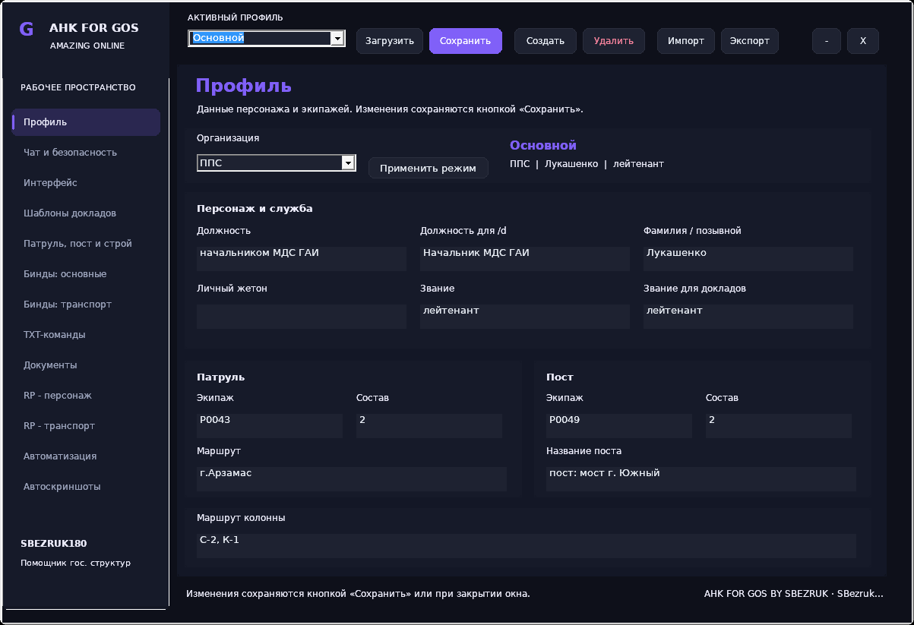

# AHK FOR GOS — АХК для госструктур Amazing Online

**AHK FOR GOS BY SBEZRUK** — бесплатный открытый АХК для Амазинга (Amazing Online / GTA San Andreas Multiplayer): бинды МВД и ГАИ, RP-действия, доклады, Auto ID, профили и законодательство. Автор и сопровождающий — **sbezruk180**. Текущая опубликованная версия — **1.1**.

**AHK FOR GOS** is an open-source AutoHotkey assistant for government factions in Amazing Online. This is the official project repository, including all application modules, build tools, installer sources, documentation and Windows downloads.

[**Сайт проекта**](https://sbezruk180.github.io/AHK-FOR-GOS-BY-SBEZRUK/) · [**Скачать 1.1**](https://github.com/sbezruk180/AHK-FOR-GOS-BY-SBEZRUK/releases/tag/v1.1) · [**Все функции и бинды**](FEATURES.md) · [Сборка](docs/desktop/BUILD_AND_RUN_RU.md) · [Сообщить об ошибке](https://github.com/sbezruk180/AHK-FOR-GOS-BY-SBEZRUK/issues)

## Скачать AHK FOR GOS

| Файл | Назначение |
| --- | --- |
| [Установщик Windows](https://github.com/sbezruk180/AHK-FOR-GOS-BY-SBEZRUK/releases/download/v1.1/AHK_FOR_GOS_Setup.exe) | Установка AHK или EXE. Рекомендуется вариант AHK; локальный интерпретатор включён. |
| [AHK со всеми зависимостями](https://github.com/sbezruk180/AHK-FOR-GOS-BY-SBEZRUK/releases/download/v1.1/AHK_FOR_GOS_AHK_v1.1.zip) | Исходные модули, laws, ресурсы и локальный ANSI x86 интерпретатор. |
| [Самостоятельный EXE](https://github.com/sbezruk180/AHK-FOR-GOS-BY-SBEZRUK/releases/download/v1.1/AHK_FOR_GOS.exe) | Приложение без отдельной установки AutoHotkey. |
| [Унинсталлер](https://github.com/sbezruk180/AHK-FOR-GOS-BY-SBEZRUK/releases/download/v1.1/AHK_FOR_GOS_Uninstall.exe) | Отдельная программа удаления с выбором режима. |
| [Контрольные суммы](https://github.com/sbezruk180/AHK-FOR-GOS-BY-SBEZRUK/releases/download/v1.1/SHA256SUMS.txt) | Проверка файлов релиза SHA-256. |

[Полное описание релиза](RELEASE_NOTES_1_1_RU.md) · [Инструкция установщика](installer/README_RU.md)

## Что умеет АХК для гос

- **Бинды и TXT-команды:** настраиваемые клавиши и текстовые триггеры; игровой чат или собственное окно ввода, английские алиасы и ввод в другой раскладке.
- **Auto ID:** предложение ID при наведении, принятие F1 / отказ F2, замена предложения при смене цели. Есть ручной ввод и трёхсекундный перехват цифр.
- **Чат:** память, вставка, печать всего текста и два варианта фракционной печати; постоянный интервал или случайный темп в диапазоне символов в секунду.
- **RP и доклады:** задержание, документы, досмотр, права, розыск, патруль, пост, вызовы, транспорт и другие действия из каталога.
- **Автоматизации:** последовательности, очередь, задержки, отмена и конструктор действий с проверкой, предпросмотром и копированием сценария.
- **GPS:** маршруты на дом и организацию через последовательность ввода в игровое меню.
- **Законодательство:** 20 документов, поиск статей, страницы и памятки; отдельное текстовое окно прав и расписание ВГП/RP-каптов.
- **Профили и интерфейс:** INI, импорт/экспорт, HUD, служебные окна, темы и исключение окон из поддерживаемого захвата OBS.
- **Chatlog и диагностика:** распознавание событий, контекстные действия, журналы и внутренние отчёты.

[Каталог всех 93 зарегистрированных действий с исходными клавишами, TXT и ссылками на код](FEATURES.md). Полный [технический индекс функций](docs/desktop/FUNCTIONS_RU.txt) включает также внутренние компоненты, которые не являются отдельными кнопками.

## Исправления меню и исходный профиль — 26.10.2026

Уменьшены лишние перерисовки меню. Переключатель OBS применяется сразу; `Off` снимает защиту также с приватного ввода TXT. На первом запуске используется профиль автора из комплекта, существующие INI сохраняются. [Подробности и проверки](docs/desktop/GUI_CAPTURE_DEFAULT_PROFILE_20261026_RU.md).

## Начало работы

1. Скачайте установщик из официального релиза и выберите **AHK** либо **EXE**. Для AHK используется включённый локальный AutoHotkey 1.1 ANSI x86.
2. Закройте другие запущенные копии. Откройте настройки **F10**, заполните профиль и настройте свои бинды.
3. Окно TXT-команд по умолчанию открывается **Alt+T**; способ ввода выбирается в настройках. Ваши сохранённые назначения могут отличаться.
4. Проверьте режим чата и нужные действия в своём клиенте по [списку проверки в игре](docs/desktop/REAL_GAME_CHECKLIST_RU.txt).

Установщик работает без интернета. Установка унинсталлера необязательна. Полное удаление выполняется без корзины: перед подтверждением проверьте список выбранных файлов и папок.

Настройки новой установки находятся в `%APPDATA%\AHK FOR GOS`; прежние INI рядом с EXE продолжают поддерживаться. Для запуска исходников из GitHub нужны совместимый ANSI x86 интерпретатор и все модули — [инструкция](docs/desktop/BUILD_AND_RUN_RU.md).

## Весь проект в основной ветке

| Часть проекта | Исходники |
| --- | --- |
| Точка входа и модули приложения | [AHK_FOR_GOS_BY_SBEZRUK.ahk](AHK_FOR_GOS_BY_SBEZRUK.ahk), [app](app) |
| Работа с игрой, чат, ID и стили | [UDF](UDF.ahk), [common](common.ahk), [helper](helper.ahk), [chat_typing](chat_typing.ahk), [id_capture](id_capture.ahk), [runtime_support](runtime_support.ahk), [service_ui](service_ui.ahk), [ui_style](ui_style.ahk) |
| Законодательство и ресурсы | [laws](laws), [assets](assets) |
| Установщик и унинсталлер | [installer/native](installer/native) |
| Сборка, проверки и автоматизация | [tools](tools), [tests](tests), [build.ps1](build.ps1), [GitHub Actions](.github/workflows) |
| Готовые программы | [Релиз 1.1](https://github.com/sbezruk180/AHK-FOR-GOS-BY-SBEZRUK/releases/tag/v1.1), [release](release) |

Для сохранения совместимости используются AutoHotkey v1.1 ANSI x86 и WinAPI. [Технический анализ выбора стека](docs/desktop/ANALYSIS_RU.md) · [Архитектура](docs/desktop/ARCHITECTURE_RU.md) · [Сборка и запуск](docs/desktop/BUILD_AND_RUN_RU.md)

## Проверки и совместимость

[Результаты проверок](docs/desktop/TEST_RESULTS_RU.md) · [Таблица переноса функций](docs/desktop/FUNCTION_MAPPING.csv) · [Известные ограничения](docs/desktop/LIMITATIONS_RU.md) · [Аудит логики](docs/desktop/LOGIC_AUDIT_RU.md)

Установщик/унинсталлер рассчитаны на Windows 10/11 x64. Приложение работает с 32-битным клиентом и совместимой CP1251. Адреса памяти, Auto ID, GPS, ввод и скрытие OBS зависят от клиента, версии Windows и метода захвата. Сборка и автоматические проверки не подтверждают работу каждого действия на вашем сервере.

Проект не является официальной программой Amazing Online. Проверяйте правила сервера: автор не гарантирует отсутствие ограничений или блокировок аккаунта.

## Инструкции по отдельным возможностям

[Ввод и TXT-команды](docs/desktop/INPUT_FIXES_RU.md) · [Режимы и скорость печати](docs/desktop/FACTION_SPEED_RU.md) · [Сигналы, конструктор и GPS](docs/desktop/SIGNALS_BUILDER_GPS_RU.md) · [Права в текстовом окне](docs/desktop/RIGHTS_GUI_RU.md) · [Интерфейс](docs/desktop/GUI_REDESIGN_RU.md) · [Исправления удаления](docs/desktop/UNINSTALL_FIX_20261023_RU.md)

## Помощь и развитие

При сообщении об ошибке укажите версию, выбранный режим отправки, точную последовательность действий и текст диагностики. Не публикуйте личные данные профиля и игровые пароли.

[Создать issue](https://github.com/sbezruk180/AHK-FOR-GOS-BY-SBEZRUK/issues/new) · [Внести изменения](CONTRIBUTING.md) · [История изменений](CHANGELOG.md) · [Лицензия](LICENSE)
