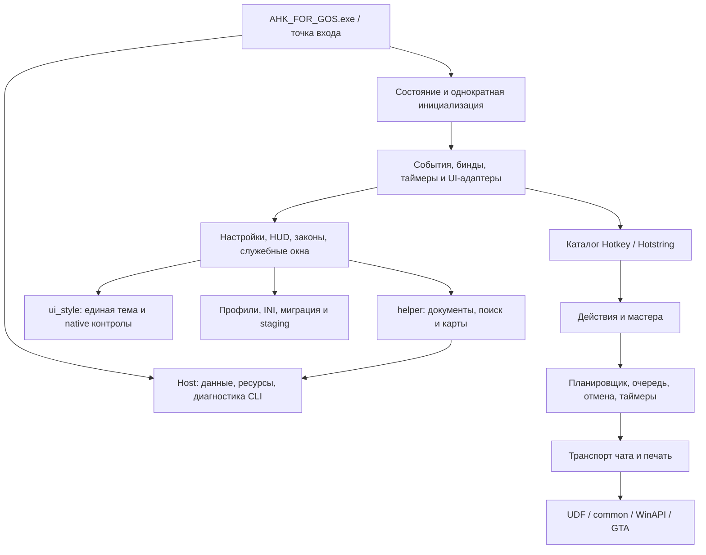

# Архитектура приложения

| Файл/подсистема | Ответственность |
|---|---|
| `AHK_FOR_GOS_BY_SBEZRUK.ahk` | Директивы, ABI-guard, граф включений |
| `app/host.ahk` | Папка данных, перенос INI, встроенные ресурсы/источники, сведения о runtime, лицензии, завершение дочерней диагностики |
| `app/state.ahk`, `app/bootstrap.ahk`, `app/cli.ahk` | Состояние, однократный запуск, ранние CLI-режимы |
| `app/core.ahk` | Mutex, нормализация, служебные фасады, запуск диагностик |
| `app/game.ahk`, `UDF.ahk`, `common.ahk` | AZMP, цель, процессы, память, WinAPI, владение HANDLE/выделениями/потоками |
| `app/bindings.ahk`, `app/events.ahk` | Реестр биндов, диспетчеризация и адаптеры обработчиков |
| `app/actions.ahk`, `app/custom_functions.ahk` | Прикладные действия, контекстные мастера, конструктор сценариев |
| `app/automation.ahk` | Очередь, планировщик, автодоклады, отмена и action timers |
| `app/chat.ahk`, `chat_typing.ahk`, `id_capture.ahk` | Отправка, клавиатура, раскладка и перехват ID |
| `app/chatlog.ahk` | Курсор/поколение chatlog, распознавание событий, доказательства |
| `app/profiles.ahk` | INI, профили, темы, миграция и атомарная запись |
| `app/ui_settings.ahk`, `app/ui_overlays.ahk`, `app/ui_documents.ahk` | Настройки/каталог страниц, HUD/списки, окна документов |
| `service_ui.ahk`, `ui_style.ahk`, `runtime_support.ahk` | Служебное представление, тема/контролы, захват/фокус/общие контракты |
| `helper.ahk` | Единственная реализация LAW, поиска, пагинации и карт |
| `app/diagnostics.ahk`, `tests/` | Диагностика и встроенные проверки; без игры по умолчанию |

На первом этапе сохранены API и глобальное состояние AHK, чтобы не изменить поведение сценариев. Это не полное устранение всех связей между view и legacy globals. UI-контролы и разметка теперь локализованы в UI-модулях; единая тема — в `ui_style.ahk`, каталог страниц — в `GetSettingsPageCatalog()`, сохранение данных — в profiles. При будущем редизайне следует сохранять команды/контракты, а заменять представление и адаптеры. Новые бизнес-сценарии следует добавлять в actions/automation, а не в создание GUI-контролов.

Сборка не запускает второй интерпретатор. В PE помещаются объединённый UTF-8-скрипт, CP1251 LAW, сведения/исходники для диагностики и лицензии. Ресурсы читаются прямо через FindResource/LoadResource. Никакие исполняемые компоненты не распаковываются. По запросу диагностической кнопки может кратковременно запускаться **этот же EXE** в раннем CLI-режиме; он не выполняет обычную инициализацию, а основной процесс держит и закрывает его HANDLE. При обычной работе используется один процесс приложения.
