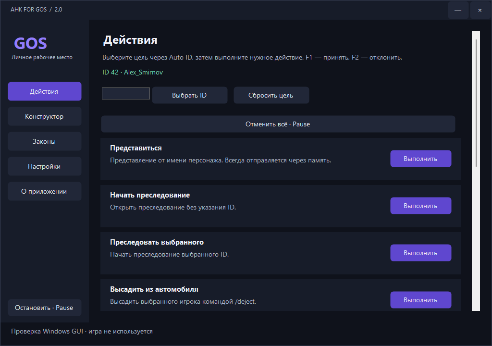

# GOS 2 — отдельная версия на C#

Экспериментальная версия **2.0.0-preview.1**, C# / .NET 10 LTS / WinForms / Windows x86. Старый AHK 1.1 и его пользовательские данные остаются отдельными. Новая программа не запускает AutoHotkey и не требует его установки.


[Скачать EXE](https://raw.githubusercontent.com/sbezruk180/AHK-FOR-GOS-BY-SBEZRUK/csharp-v2-build-41395670361/versions/2.0-csharp/download/Gos.exe) · [Исходники отдельным архивом](https://raw.githubusercontent.com/sbezruk180/AHK-FOR-GOS-BY-SBEZRUK/csharp-v2-build-41395670361/versions/2.0-csharp/download/Gos-2.0-CSharp-Source.zip) · [Отчёт и ограничения](docs/REPORT_RU.md)

## Быстрый старт

1. Закрыть старую AHK-версию, чтобы её бинды не конфликтовали с новой. Запустить `Gos.exe`. Среда .NET включена в единый EXE. При первом старте .NET может распаковать свои native-библиотеки в системную временную папку — отдельная установка runtime не нужна.
2. В «Настройках» заполнить имя, звание, организацию. При необходимости явно импортировать старый INI; оригинал не изменяется. Импортируется выбранный профиль и поддерживаемые параметры, а не весь старый AHK.
3. Выбрать отправку: **случайная печать**, **одна клавиша — один символ** или **память**. Задать диапазон символов/секунду и отдельно паузу между сообщениями. Представление, требование остановки и обычные права всегда используют память по заданию.
4. Настроить путь к `chatlog.txt` и свой игровой `Nick_Name` для распознавания событий.
5. Вернуться в игру. **F10** — меню, **Alt+T** — окно команд, **F1/F2** — принять/отклонить предложенный ID, **Pause** — отменить последовательность. Горячие клавиши действий назначаются в настройках.

На рабочем столе меню редактируется обычным образом. В игре окно не активируется: выбрать поле мышью, затем вводить; Esc завершает ввод/закрывает окно. Законы и права прокручиваются в отдельных окнах. Для системного диалога импорта INI меню нужно открыть на рабочем столе.

Настройки находятся в `%APPDATA%\AHK FOR GOS\v2\settings.json`. Атомарная запись, резервная копия предыдущего валидного файла, отказ перезаписывать более новую схему. «Сохранить» применяет подготовленные настройки; «Отменить изменения» отбрасывает черновик. Закрытие окна не подменяет явное сохранение. Завершение программы — через значок возле часов.

## Перенесённый объём

| Возможность | Реализация |
| --- | --- |
| Представление | Персонализируемый текст, всегда память |
| Chase / Chase с ID | `/chase`, `/chase {id}` |
| Dejected | Команда игры `/deject {id}`; слово `dejected` — алиас |
| Cuff / InCar | `/cuff {id}`, RP-последовательность и `/incar {id}` |
| Остановка | Два требования через память, повторный запуск не чаще одного раза в 30 секунд; остальные действия не ждут этот таймер |
| SOS | Исходная последовательность `/sos → пауза → Down → пауза → Enter` |
| Права | Пять исходных сообщений через память; отдельное локальное окно памятки |
| Auto ID | ПКМ на игроке; точное соответствие CPed и playerpool; F1/F2; смена прицела заменяет предложение без ожидания ответа |
| События chatlog | Предложение ID при собственном преследовании, реанимации, оглушении и поиске местоположения; собственные серверные строки, ограничение повторов. Принятие остаётся за пользователем |
| Окружающие | Загруженные клиентом игроки в радиусе: ID, ник, 3D-расстояние, количество; максимум 12 ближайших строк с полным счётчиком |
| HUD | Цель, предложение ID, режим отправки и текущий статус; перемещение мышью |
| Конструктор | Сообщения, паузы, уведомления и ограниченные клавиши меню; добавление, редактирование, перестановка, удаление, предпросмотр, сохранение и запуск |
| Текстовое окно | Поиск команд по русским/английским названиям и алиасам; сохранённые сценарии, стрелки, Tab, Enter, Esc |
| Документы | Все 20 исходных текстовых корпусов встроены в EXE, поиск и чтение без интернета |
| OBS | Централизованный SetWindowDisplayAffinity; переключение On/Off во всех собственных окнах |

Новая версия переносит выбранный пользователем набор, а не все 93 действия старого проекта. Неперенесённые GPS, старые карточки происшествий, полный журнал действий, карты с отсутствующими изображениями, прочие действия AHK и старые скрипты конструктора не объявляются реализованными в C#.

## Как работают режимы отправки

**Случайная печать.** Настоящие scan-code нажатия в игровом чате; диапазон задаётся в символах/секунду. Итоговая скорость включает удержание клавиши около 10 мс и ограничения клиента, поэтому 500 симв./сек. не обещается. Буфер обмена для отправки не используется. Русская и английская раскладки выбираются при необходимости; исходная раскладка восстанавливается, если активным остаётся то же окно.

**Одна клавиша — один символ.** Нажатие обычной физической клавиши разрешает ввод одного следующего символа подготовленной команды. Быстрые нажатия сохраняются только в пределах текущей строки; автоповтор удержанной клавиши не считается новым нажатием. Введённые приложением клавиши не засчитываются повторно. Enter отправляется после последнего символа. Pause/Esc отменяют; Ctrl/Alt/Win прерывают ввод, чтобы системные сочетания не превратились в игровые команды. При удержанном модификаторе приложение может оставить неотправленный чат открытым: отпустить клавишу и закрыть чат вручную.

**Память.** Явное CP1251-кодирование, исходные x86-функции AZMP, проверка PE/страниц и необязательного ожидаемого SHA-256. Неизвестный результат не повторяется. Память незавершённого удалённого потока не освобождается под выполняющимся кодом; до его завершения новые такие вызовы блокируются. Если приложение закрыто раньше, остаточное выделение освобождается процессом игры при его завершении.

Нет накопительной очереди: одновременный сценарий отклоняется. Pause отменяет ожидания и последующие шаги. Уже запущенный игровой вызов нельзя физически отозвать. Смена выбранной цели отменяет прежнюю последовательность; перед отправкой и подтверждением печати цель повторно проверяется.

## Полноэкранная игра и ограничения

- Пассивные окна используют `WS_EX_NOACTIVATE` и не вызывают активацию GTA/других приложений. Рабочий маршрут — оконный полноэкранный режим без рамки с DWM.
- **Настоящий эксклюзивный DirectX fullscreen не гарантирует видимость внешних окон.** В этой версии нет внедрения графического overlay в игру. Это открытое ограничение, а не проверенное выполнение требования для всех fullscreen-режимов.
- Реальные адреса и поведение конкретной сборки Amazing требуют клиентского теста. Структурные проверки PE и собственная x86-фикстура не подтверждают все игровые функции.
- Список окружающих включает только доступных в памяти клиента игроков, не NPC и не всех подключённых к серверу. Пустой список может означать отсутствие читаемых данных; статус связи находится в приложении.
- Маски с отдельным большим номером из 3D-метки не портированы; новый ID ограничен игровыми слотами 0–1003. Ближайший игрок не выдаётся за точную цель.
- Тексты законов — комплект из старого проекта. Их актуальность на сервере автоматически не проверяется. Содержимое и источники сохранены.
- Windows-флаг защиты захвата проверяется; реальные кадры OBS и каждый метод захвата проверяются отдельно. Подпись издателя в этой preview отсутствует.

## Сборка и тесты

Установить .NET 10 SDK. На Windows: `./build.ps1`. На Linux с .NET 10 SDK: `sh build.sh`; cross-publish собирает Windows-приложение, но не запускает его GUI.

```
dotnet run --project tests/Gos.Tests -c Release
dotnet build src/Gos.Windows/Gos.Windows.csproj -c Release
```

Готовый файл: `out/win-x86/Gos.exe`, рядом SHA256SUMS. Он публикуется self-contained/single-file; все 20 законов встроены. Тексты законов сохранены отдельным снимком в `src/Gos.Core/Laws`; тестовый старый INI находится в `tests/Gos.Tests/Fixtures`. Для сборки достаточно папки новой версии. Старая AHK-папка не требуется.

`Gos.exe --ui-selftest <одноразовая-папка>` запускает отдельную проверку нативных окон, снятия affinity, реальных scan-code русской/английской печати в собственном окне и исходного stdcall в собственной памяти. Пользовательские/игровые данные для этого не нужны. Игра в этом режиме не проверяется.

Windows workflow: `.github/workflows/csharp-v2.yml`. Результат, EXE и снимки сохраняются в отдельной ветке сборки. Исходники preview живут в `v2-csharp-preview`; стабильная ветка и релиз AHK 1.1 не заменяются.

## Снимок интерфейса

Реальное окно на Windows-тестовом стенде; имена и ID заданы фикстурой, игра не запущена.


